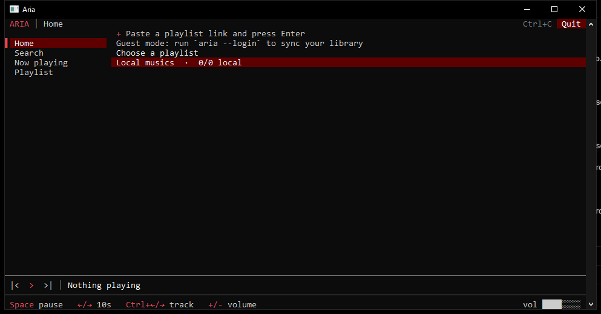

# Aria

A lightweight YouTube Music client for the terminal, written in Rust.

Aria is a TUI that streams YouTube Music straight from memory: no browser, no
Electron, no account required. Search and play public music right away; sign in
only if you want your own library and playlists.



## Features

- **Works without a Google account.** Anonymous search, playback and playlist
  import out of the box.
- **Optional sign-in** to load your YouTube Music library and playlists.
- **Mouse-first UI:** click the sidebar, lists, player buttons, progress bar and
  volume bar. Drag the progress line to seek.
- **Import any playlist** by pasting a YouTube Music link in the Home screen.
- **Autoplay radio:** when the queue reaches its last track, similar songs are
  fetched and appended automatically, so the music never stops.
- **Streams into RAM** (`yt-dlp` resolves the URL, audio is decoded in memory),
  so nothing is written to disk while listening.
- **Small footprint:** a single native binary, ~20-40 MB of RAM while playing.
- **Cross-platform:** Windows, Linux and macOS.

## Requirements

- [yt-dlp](https://github.com/yt-dlp/yt-dlp) in `PATH` (default downloader).
- A terminal with mouse support (Windows Terminal, conhost, GNOME Terminal,
  iTerm2, kitty, alacritty...).
- To build: Rust 1.75+ and a C toolchain.
  - Linux: `libasound2-dev`, `libdbus-1-dev`, `pkg-config`.
  - macOS: Xcode command line tools.
  - Windows: MSVC build tools (WebView2 is used for the optional login window).

## Install

One command, no Rust required:

**Linux** (installs to `~/.local/bin`, adds it to your PATH):

```bash
curl -fsSL https://raw.githubusercontent.com/laopro/aria/main/install.sh | sh
```

**Windows** (PowerShell; installs to `%LOCALAPPDATA%\Aria`, adds it to your PATH):

```powershell
irm https://raw.githubusercontent.com/laopro/aria/main/install.ps1 | iex
```

Then open a new terminal and run `aria`.

Other options:

- Download the prebuilt binary from
  [releases](https://github.com/laopro/aria/releases): `aria-linux-x86_64.AppImage`,
  `aria-linux-x86_64.tar.gz`, `aria-windows-x86_64.exe` or the portable Windows zip.
- macOS: build from source (below).
- From source on any platform:

```bash
cargo install --path crates/aria --locked
```

or build a release binary:

```bash
cargo build --release
# target/release/aria (aria.exe on Windows)
```


## Update

```bash
aria --update
```

Downloads the latest release and replaces the installed binary (Windows and Linux).

## Usage

```bash
aria
```

On first run there is no session: Aria starts in **guest mode**. You can search,
play, queue tracks and import playlists. To sync your library:

```bash
aria --login            # Windows: opens a WebView2 window; other OSes: browser + cookie import
aria --login chrome     # pick a browser explicitly
```

Other flags:

| Flag | Description |
| --- | --- |
| `-h`, `--help` | Show usage and shortcuts |
| `--login [browser]` | Save a YouTube Music session |
| `--files` | Print config/cache/log paths |
| `--fix-db` | Repair the local database |
| `--clear-cache` | Delete cached files |

## Keyboard shortcuts

| Key | Action |
| --- | --- |
| `Space` | Play / pause |
| `Enter` | Open the selected playlist or play the selected track |
| `f` | Search |
| `s` | Shuffle the queue |
| `r` | Remove the selected track from the queue |
| `←` / `→` | Seek 5 seconds |
| `Ctrl+←` / `Ctrl+→` | Previous / next track |
| `+` / `-` | Volume up / down |
| `Esc` | Back |
| `Ctrl+C` / `Ctrl+D` | Quit |

Everything also works with the mouse: the player bar has previous, play/pause
and next buttons, a clickable progress line and a clickable volume bar.

## Configuration

Aria stores its files in the standard per-user directories:

- Windows: `%APPDATA%\laopro\aria\config\config.toml`
- Linux: `~/.config/aria/config.toml`
- macOS: `~/Library/Application Support/com.laopro.aria/config.toml`

Run `aria --files` to print the exact paths.

A manual session can be provided with a `headers.txt` file:

```
Cookie: <cookie header from music.youtube.com>
User-Agent: <your user agent>
```

## How it works

- `crates/ytpapi2` talks to the YouTube Music InnerTube API (search, playlists,
  library) with or without cookies.
- `crates/player` decodes audio with `rodio` from an in-memory buffer.
- `crates/aria` is the TUI (`ratatui` + `crossterm`) and the player state
  machine.
- `yt-dlp -g` resolves the stream URL; the audio bytes are fetched with `ureq`
  and never touch the disk.

## License

MIT, see [LICENCE](LICENCE).
