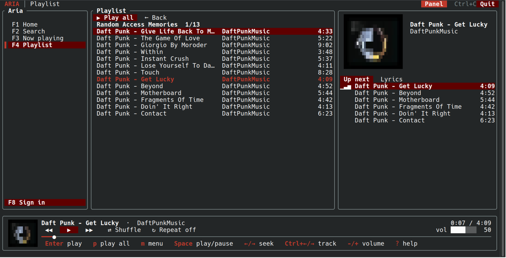

# Aria

A lightweight YouTube Music client for the terminal, written in Rust.

Aria streams YouTube Music straight into memory: no browser, no Electron, and
no account needed to start. Search and play right away; sign in when you want
your library, likes and playlists, and every change you make in Aria goes back
to your YouTube Music account.



## Features

- **Works without a Google account.** Search, play, queue and import public
  playlists as a guest.
- **Sign in from inside the app** (`F8` or the sidebar button). Aria reuses the
  YouTube Music session of your browser and loads your library, playlists,
  Liked Music and history. When the session expires it reads it again by itself.
- **Two-way account sync.** Like tracks, add them to or remove them from your
  playlists, create and delete playlists: the change reaches YouTube Music at
  once. Playlists refresh when you open them, and `F5` on Home reloads the
  whole library, so edits made on the phone or in the browser show up too.
- **Picks up where you left off.** The open playlist, the queue, the track and
  its position, the volume, repeat and the side panel come back on the next start.
- **Search** with All (best matches first), Songs, Videos and Playlists tabs.
- **Right panel** with a large album cover, the queue and the lyrics.
- **Album covers** in 24-bit color terminals; only covers of played tracks are
  saved, at 3 KB each.
- **Mouse and keyboard alike.** Double click plays, right click opens a menu
  (play next, add to queue, like, add to playlist, copy link...), the wheel
  scrolls, scrollbars and the progress bar can be dragged, and every hint in the
  bottom bar is a button. Everything also has a key; press `?` to see them all.
- **Autoplay radio:** when the queue runs out, similar songs are added.
- **Streams into RAM** (`yt-dlp` resolves the stream, the audio is decoded in
  memory), so nothing is written to disk while listening.
- **Small footprint:** a single native binary using about 20 MB of RAM with a
  large library loaded, idle or playing.
- **Themes:** `red` (default), `mono` and `light`.

## Install

**Linux (x86_64)**, no Rust required. This installs Aria to `~/.local/bin`, adds
it to your PATH and fetches `yt-dlp` if you do not have it:

```bash
curl -fsSL https://raw.githubusercontent.com/laopro/aria/main/install.sh | sh
```

Open a new terminal and run `aria`. An AppImage and a `.tar.gz` are also on the
[releases](https://github.com/laopro/aria/releases) page.

**Windows 10/11**: paste this in PowerShell. It installs Aria and `yt-dlp` to
`%LOCALAPPDATA%\Aria` and adds it to your PATH:

```powershell
irm https://raw.githubusercontent.com/laopro/aria/main/install.ps1 | iex
```

Open a new terminal (Windows Terminal is best) and run `aria`. The `.exe` from
the releases page also works on its own: on the first start it downloads
`yt-dlp.exe` next to itself.

**macOS:** build from source for now.

### Build from source

Requirements: Rust 1.75+, a C toolchain and [yt-dlp](https://github.com/yt-dlp/yt-dlp)
in `PATH`.

- Linux: `libasound2-dev`, `libdbus-1-dev`, `pkg-config` (Debian/Ubuntu), or
  `alsa-lib-devel`, `dbus-devel`, `pkgconf-pkg-config` (Fedora).
- macOS: Xcode command line tools.
- Windows: MSVC build tools.

```bash
cargo install --path crates/aria --locked
# or: cargo build --release   ->  target/release/aria
```

## Update

```bash
aria update
```

Downloads the latest release, checks it arrived whole, replaces the installed
binary (or the AppImage) and updates the `yt-dlp` that the installer put next to it.
On Aria 0.3.0 and older, type `aria --update` (with dashes) once.

## Usage

```bash
aria
```

Aria starts in guest mode. Press `F8` (or click **Sign in** in the sidebar) to
use your account: it picks up the YouTube Music session of your browser, or
opens the sign-in page and waits for you.

| Flag | Description |
| --- | --- |
| `-h`, `--help` | Usage and shortcuts |
| `update`, `--update` | Update Aria (and its yt-dlp) |
| `--login [browser]` | Save a session from a terminal, e.g. `aria --login firefox` |
| `--files` | Print the config, cache and log paths |
| `--fix-db` | Repair the local database |
| `--clear-cache` | Delete cached files |

## Keys

| Key | Action |
| --- | --- |
| `Space` | Play / pause |
| `←` / `→` | Seek 5 seconds |
| `Ctrl+←` / `Ctrl+→` | Previous / next track |
| `-` / `+` | Volume |
| `s` / `r` | Shuffle the queue / repeat off, all, one |
| `F1` `F2` `F3` `F4` | Home, Search, Now playing, Playlist |
| `F6` / `F7` / `F8` | Right panel / lyrics / sign in |
| `Enter` | Play the track or open the playlist |
| `m` | Menu of the selected track (like, add to playlist, play next...) |
| `Del` | Remove from the queue (Now playing) · delete a playlist (Home, press twice) |
| `n` / `F5` | New playlist / sync with the account (Home) |
| `Tab` / `Shift+Tab` | Search filters |
| `/` | Back to the search box |
| `Esc` | Back |
| `?` | Every key and mouse action |
| `Ctrl+C` | Quit |

With the mouse: one click selects (and opens a playlist), a double click plays,
a right click opens the menu. The wheel scrolls lists, changes the volume over
the player and seeks over the progress line.

## Configuration

`config.toml` lives in the standard per-user directory (`~/.config/aria/` on
Linux); run `aria --files` for the exact paths. For example:

```toml
[player]
theme = "mono"        # "red" (default), "mono" or "light"
initial_volume = 50
```

A session can also be given by hand in `headers.txt` next to it:

```
Cookie: <cookie header from music.youtube.com>
User-Agent: <your user agent>
```

## How it works

- `crates/ytpapi2` talks to the YouTube Music InnerTube API (search, playlists,
  library, lyrics and account edits), with or without a session.
- `crates/player` decodes audio with `rodio` from an in-memory buffer.
- `crates/download-manager` resolves streams with `yt-dlp` and downloads them
  in ranged chunks, which YouTube does not throttle.
- `crates/aria` is the interface (`ratatui` + `crossterm`) and the player state.

## License

MIT, see [LICENCE](LICENCE).
